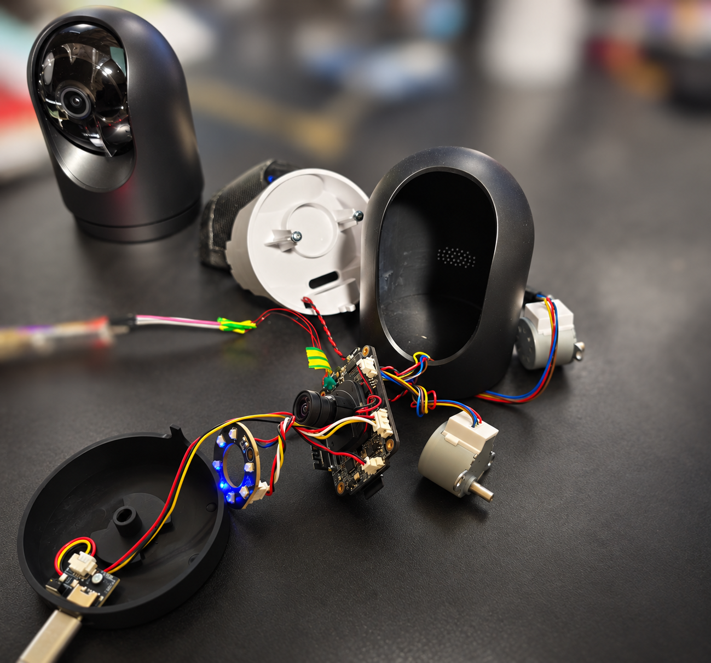
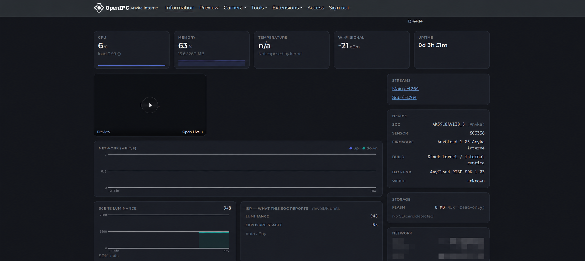
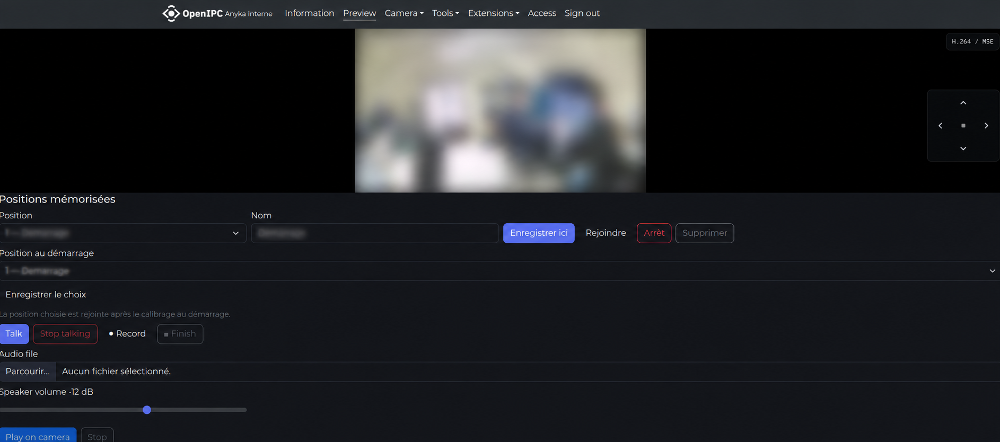
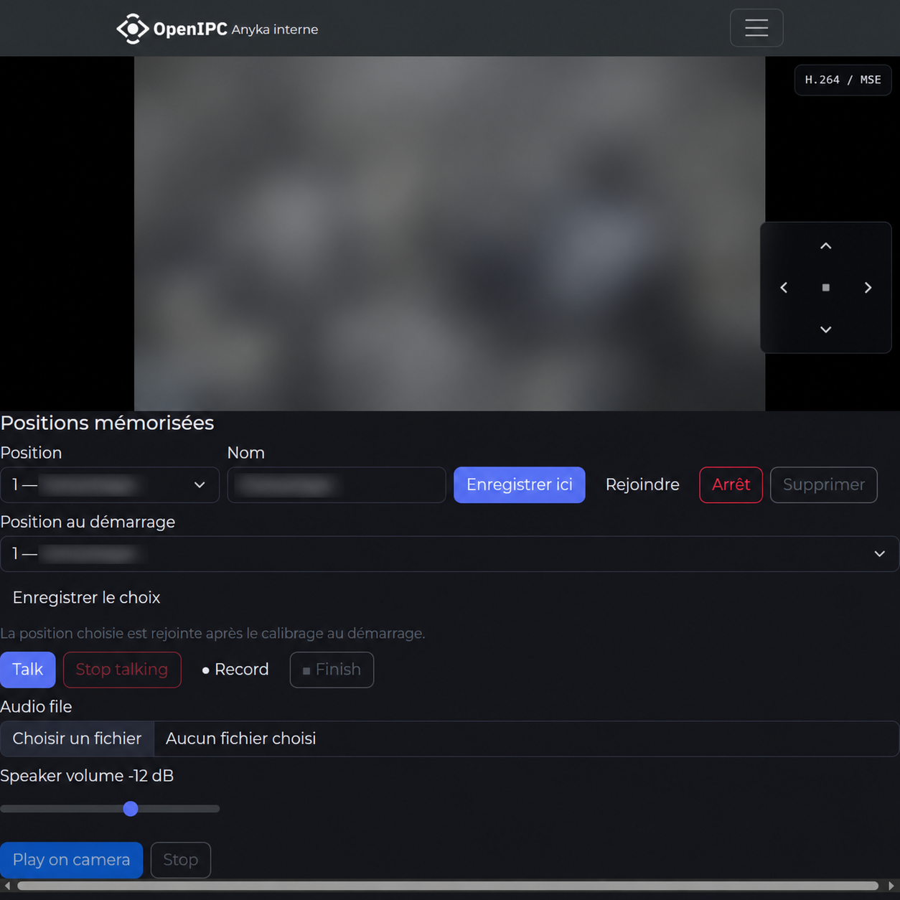
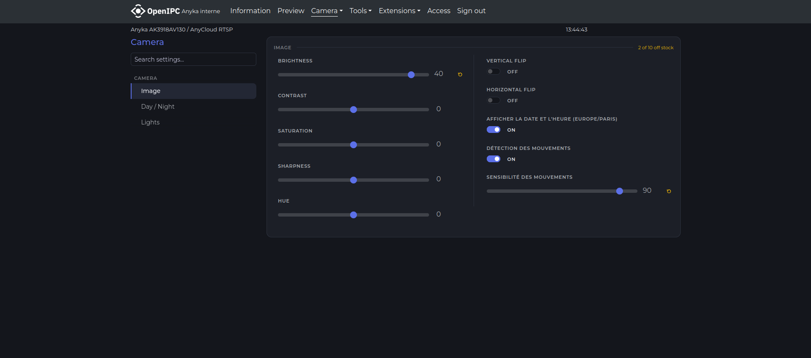

# OpenIPC experimental port — GP5_A10S14A5 / Anyka AK3918AV130

**Documentation and source handoff, 20 October 2026.** A working internal-NOR experiment on one ARMv5 camera, with native C gateway, OpenIPC WebUI, authenticated RTSP, audio, PTZ presets and Home Assistant controls.

**This is not an official OpenIPC release or a ready-to-flash image.** It retains the stock kernel/drivers and proprietary SDK inputs. Upstream integration needs architectural, licensing, reproducibility and physical-validation work. Original-code license selection is pending owner confirmation; third-party licenses are retained.

[Français](README.fr.md) · [Complete documentation index](docs/README.md) · [Hardware](docs/hardware.md) · [Build](docs/build.md) · [Observed results](docs/validation.md) · [Upstream plan](docs/upstream.md)

## Camera and interface

The screenshots below are prepared for publication: the video scene, preset names and network identifiers are redacted. The camera photograph is an edited illustration; see the hardware notes for board identification.











## Start here

1. Read [scope and support](docs/status.md), [architecture](docs/architecture.md) and [NOR layout](docs/flash-layout.md).
2. Inspect [source map](docs/source-map.md), [dependencies](manifests/dependencies.json) and [license status](docs/licensing.md).
3. Build the standalone [C gateway](docs/build.md), or study the explicitly incomplete full-image pipeline.
4. Use the [integration issue draft](upstream/ISSUE-DRAFT.md) and [small-PR plan](upstream/PR-PLAN.md) after review.

## What is included

Original port sources, C gateway and vendored open-source JSON/crypto, SDK extension source, camera WebUI templates/assets, internal userspace builders/configuration, legacy research code, Home Assistant custom integration/card, board/partition data, dependency inventory, source provenance and curated measured observations.

Private flash backups, configured images, Wi-Fi/password/host keys, proprietary SDK libraries/modules/models and unredacted deployment reports are excluded. The public SDK reference is not a redistribution license. A source-only checkout cannot currently build a complete firmware image.

## Working features and limits

- Main H.264 2304×1296 and substream 640×360 at nominal 20 fps, Digest RTSP/TCP, two public readers.
- C browser preview, JPEG, native PCM/MP3 speaker transport and implemented Anyka ISP/GPIO controls.
- Stock PTZ motor ABI, eight named positions and startup recall once after homing; shared WebUI/HA storage.
- Per-second OSD worker and bounded graceful SDK recovery.
- Short internal-boot/media checks documented; final overnight stability, physical SD-free cold power-on and real-person/tracking validation remain open.

Current OpenIPC rules prohibit shipped LD_PRELOAD integration, which this experiment still uses. The roadmap explicitly addresses that blocker rather than labeling the current runtime upstream compliant.

## Local source audit

```sh
make audit
```

This checks publication files and provenance locally; it does not build firmware, connect to a camera or run hardware/unit suites. `make gateway` builds only the standalone C gateway with an explicitly configured ARMv5 musl toolchain.

The destination retains a pre-existing OpenIPC Git history and metadata; this handoff is not a restored upstream Buildroot tree. Review existing deletions and inherited CI before any commit or public push.
