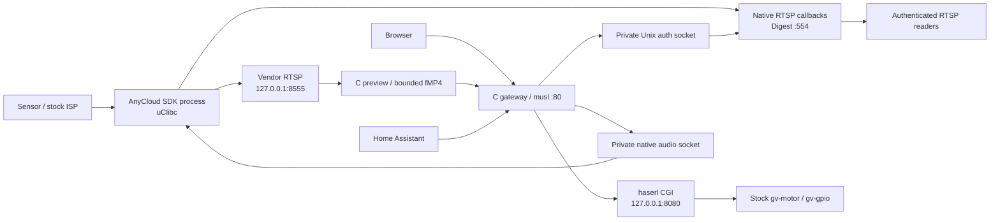

# Processes, media paths and trust boundaries

The C gateway replaces the production Go gateway. Public RTSP media is served from official SDK callbacks; it is not passed through the HTTP gateway. Browser preview independently consumes the private substream and produces fMP4 without H.264 transcoding. PCMA expands to FLAC for the browser.

The vendor listener ignores its configured RTSP username/password. It must remain isolated on loopback. The auth interposer is a mandatory security boundary, not an optional optimization. The public native server delegates Digest decisions to a root-only Unix connection and closes media when that connection closes.

Two C runtimes coexist: musl for the gateway and selected OpenIPC tools, original uClibc for the SDK. Cross-process sockets carry bounded protocols. Never load a musl shared object into the uClibc process.

The current integration uses `LD_PRELOAD` in vendor processes. Current OpenIPC contribution rules disallow this in shipped firmware. This working architecture therefore requires an agreed upstream replacement before claiming official integration.

---

[Documentation index](README.md) · [Project overview](../README.md)
