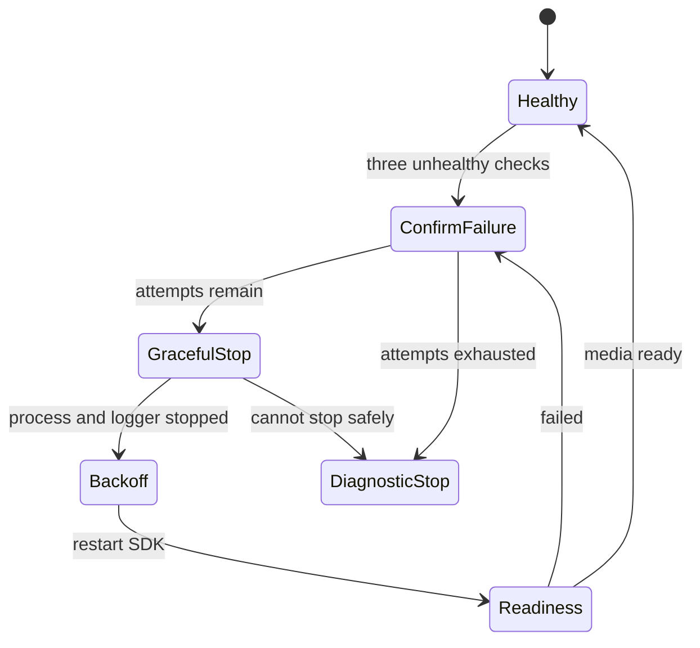

# OSD clock and bounded video recovery

The original clock update was coupled to a day/night SDK operation measured around 3049 ms plus a one-second pause. That explains four-second visual jumps despite a correct system clock. The fix gives OSD a separate uClibc thread, about 100 KiB stack, a runtime-initialized mutex, second-aligned updates and atomic stop state.

`/tmp/anyka-osd-clock.json` reports bounded RAM state; updates were measured around 1–6 ms. Twelve successive ticks were observed after boot, and a separate video crop showed consecutive rendered seconds. Thread status alone would not prove that the timestamp is visible in encoded frames.

The root monitor uses three unhealthy checks spaced five seconds apart before video recovery, at most three attempts per boot, backoffs of 10/30/60 seconds and a readiness window of 90 seconds. It requests graceful SDK termination, waits up to 20 seconds and waits up to five seconds for the old logger before starting a new SDK process.

There is no forced module unload, SIGKILL escalation, automatic reboot or PTZ rehoming during recovery. A web/network-only fault is distinguished from a video fault; recovery stops and leaves SSH for diagnosis when safe conditions are absent. Counters and markers stay in RAM, avoiding flash wear.

A controlled SDK termination recovered in 25 seconds in RAM with unchanged gateway and PTZ state. The monitor does not yet detect every case of an alive process producing frozen frames; an encoded-frame progress heartbeat remains future work.

---

[Documentation index](README.md) · [Project overview](../README.md)
